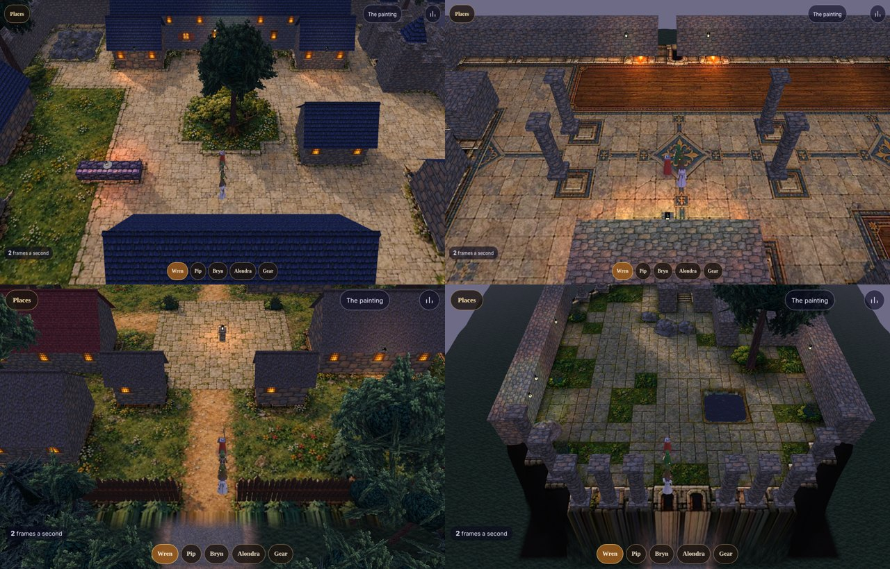

# The game's own places in 3D

Hearth & Heirloom's own maps, stood up in 3D (November 20). Published: https://claude.ai/artifact/GBxRVSqwMwYUTy1xLNjATA



Act One is in: Hearthstone Keep, the Great Hall, the Hearth Road, Thornhollow, the Thornway, Briarmaw's den, Mossfall,
the two floors of Mosswatch, the Hindwood, Fawnrest, the Eldergrove and the two depths of the Heartroot. The party walks
them in their gear; the ways out lead from one to the next, as in the 2D game (the Keep's north gate to the Hearth Road,
the Hall's door to the yard), and **Places** jumps to any of them. **The painting** shows the 2D map from above.

## Act Two (November 20, the Places job)

Each region on its own page, by day (the mines, vaults and the two dark Gloomfen maps stay dark):

| Region | Places | Page |
|---|---|---|
| The Sunscorch | 10 | https://claude.ai/artifact/Awn5YJ761bD7rPyp4AkEdf |
| The Ironspire (with the East Road) | 17 | https://claude.ai/artifact/BPcAuRLL3njp1Q3ZHPTUWQ |
| The Gloomfen | 12 | https://claude.ai/artifact/RkoGBME3ANqwAVLnwKLbj8 |

What Act Two adds to the converter and the kit (Act One is made exactly as before):
- Thick runs of cliff (`^`, and `R` in a mine, a dwarf hall, a forge or the ice cave) raise the ground itself, with
  rock wrapped round their faces (`core.js` `ground.rock`); a lone `^` is a boulder; dune crests are sand humps.
- Each region's look (`m7-kit.js` `LOOKS`, changed per biome by `BIOMES`): Chris's textures, the walls, roofs, rock,
  water and light. Its textures travel in each place's own file (`texFiles`), so a page carries only its own region's.
- What a `T`, `t`, `Y`, `f` and `"` are in each biome (`convert.mjs` `TREEK`, `SMALLK`, `YK`, `GLOWK`): palms, cacti,
  crystal spires, dead and frosted trees, mine props, columns, carved kings, anvils, ice columns; jars, carts, sledges,
  barrels, reeds; glowing veins, runes and embers.
- In the Gloomfen, plank streets and piers stand on stilts over the water, `|` are waist-high rails and `*` lanterns
  on poles.

## How a map becomes a place

`node m7/convert.mjs <map ids>` reads each map from `game/src/data/maps/` and its painting from
`game/src/ui/assets/paint/`, and writes `coven/places/m7-<id>.js` (plain data) and `coven/art/m7/<id>.webp` (the
painting, as it is). `coven/places/m7-kit.js` makes the data into a place for Coven's engine.

- One tile is 2 m by 2 m. The painting is laid over the ground as its colour, so the floor is the 2D game's own map;
  the textures under it give it grain.
- Everything that stands comes from the tiles: `~` water (the ground drops under it; fords are ankle deep), `#` and `*`
  walls (curtain walls with crenels and towers in a keep or town, low dry-stone ruins in the wilds, low walls indoors),
  `H` with the wall row under it a house or hall (a `+` in that row is its door; its roof is slate, red tiles, thatch or
  moss, by the colour the painting gives it), `|` palisades, `T` trees, `t` bushes, `o` rocks, `^` cliffs, `R` root
  walls, `Y` the First-Age roots, `f` glowing fungus, `b` bridges, `*` torches.
- Where the party can walk is exactly the 2D game's walkable tiles.
- A map walled nearly all round is indoors: the walls are low (a doll's house from above, as the 2D game shows it),
  pillars stand full height, torches hang on the walls, and past the walls there is only dark.
- Past a map's edges the land goes on 9 tiles: water where the edge is water, a bridge where one leaves, woods elsewhere.

Changes to Coven's engine (marked "Aethermoor"): the ground can take a painting as its colour (`core.js` `groundMat`,
`world.js` `ground.paint`). Nothing else.

## Build

Act Two's pages: `node build.mjs --page=m7-places --places=<the region's ids> --name=Sunscorch --out=m7-sunscorch --tex=512`
(add `--paint=0.75` for the Ironspire and the Gloomfen, to keep them under 16 MB). Checks: `NODE_PATH=$(npm root -g) node
m7/check.mjs dist/<page>.html <folder>` (stills of every place; `EXITS=1` also takes every way out), `node m7/exits.mjs`.

```
node m7/convert.mjs keep keep-hall hearth-road ...      # after a map or the converter changes
node build.mjs --page=m7-places --places=keep,keep-hall,hearth-road,...    # dist/m7-places.html (open it), .artifact.html (publish it)
```

All fourteen of Act One make a 14 MB page; the published one is built with `--tex=768` (12 MB), `--tex=512` makes 9 MB. The other 43 maps convert the same way; their
own surfaces (sand, snow, bog, molten iron) want their own textures, and those come with the texture pack.

## Not yet

- The people (they're in the data, `people`, not yet standing there), chests, locks and the fights.
- Leaves and roofs are the borrowed night textures, lit a little warmer; the 2D game is by day.
